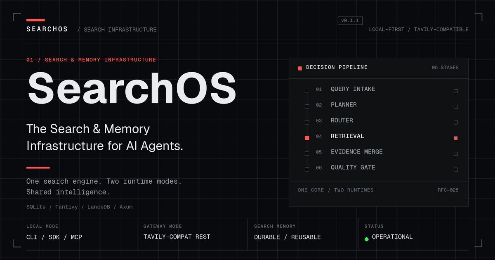
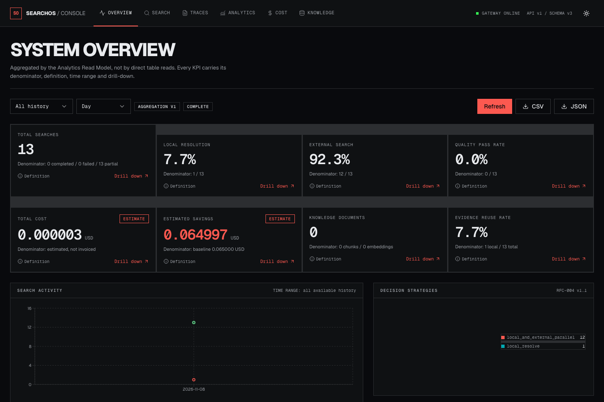
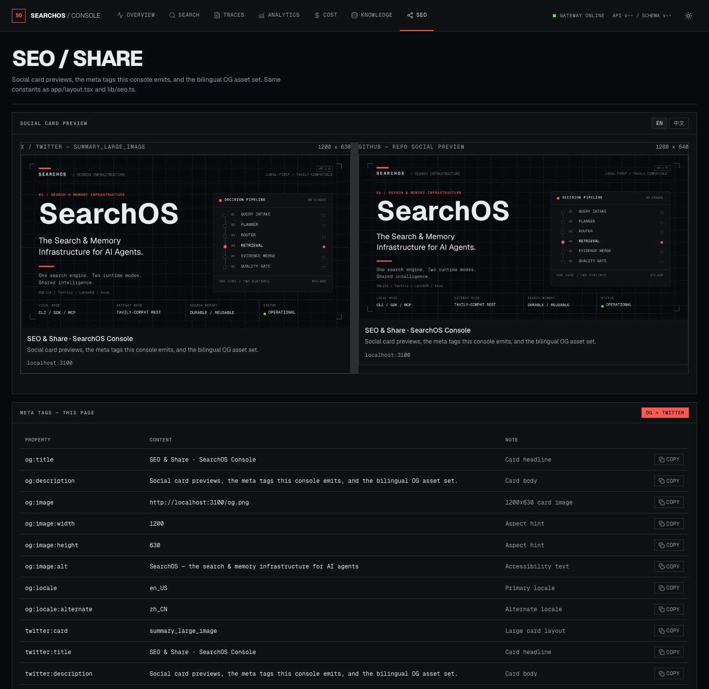

<p align="center">
  
</p>

<h1 align="center">SearchOS</h1>

<p align="center">
  <strong>The Search &amp; Memory Infrastructure for AI Agents.</strong><br/>
  One search engine. Two runtime modes. Shared intelligence.
</p>

<p align="center">
  
  
  
  
  
</p>

<p align="center">
  <a href="#quick-start">Quick Start</a> ·
  <a href="#highlights">Highlights</a> ·
  <a href="#console">Console</a> ·
  <a href="#architecture">Architecture</a> ·
  <a href="#documentation">Docs</a> ·
  <a href="README.zh.md">中文</a>
</p>

---

## Why SearchOS

AI-agent workflows depend heavily on web search, but today every agent, every tool, and
every task tends to use its own search service (Tavily, Brave, Exa…). That produces:

- The same or near-duplicate searches executed over and over.
- Search quotas that can't be managed or shared across tools.
- Fetched web content that is never reused.
- Search results with no persistence or accumulated knowledge.
- Different websites that a generic crawler can't reliably handle.
- Two different usage models for local use vs. server deployment.

SearchOS fixes this with one unifying infrastructure.

## Highlights

- **Dual Runtime** — the same Rust core runs as an in-process **Local Mode** (CLI / Rust
  SDK / MCP stdio) and as an HTTP **Gateway Mode** (Tavily-compatible REST + MCP).
- **Tavily-compatible API** — point your existing client at `http://127.0.0.1:8787` and
  keep your workflow unchanged.
- **Local-first search** — answers are served from local index/memory before any external
  request is made.
- **Search Memory** — search history, document versions, semantic memory, and research
  memory are first-class, durable assets.
- **Hybrid retrieval** — BM25 + Vector + Metadata fused with Reciprocal Rank Fusion (RRF)
  and a pluggable reranker.
- **Extensible core** — manifest lifecycle, permissions, fault-isolated discovery and
  quarantine; native providers and site crawlers are compiled into the binary.
- **Cost-aware routing** — a scoring model that balances quality, freshness, latency, cost,
  and availability; plus Singleflight request coalescing.
- **Distributed-ready** — the data model and interfaces are designed for multi-node from
  day one, without forcing distributed complexity in v1.

## Console

The operator console (`web/`) is a Next.js 16 / React 19 interface over the gateway's
**Analytics Read Model** — the browser never touches operational tables directly.

| System Overview | SEO / Share |
|---|---|
|  |  |

Seven surfaces: **Overview** (KPI cards with denominators, activity/strategy charts,
export), **Search** workbench, **Traces** (staged decision timeline), **Analytics**
(search / cost / quality / knowledge / providers / crawlers / infrastructure), **Cost**
(ledger, reservations, reconciliation), **Knowledge** (documents, semantic memory,
runtime health) and **SEO** (social card previews + the meta tags this site emits).
Light / Dark, square-cornered tactical telemetry, one hazard-red accent. See
[docs/ui.md](docs/ui.md) and [web/README.md](web/README.md).

## Quick Start

### Prerequisites

- Rust 1.75+ (`rustup`)
- Node.js 20+ (console only)

### 1. Build and run the CLI (Local Mode)

```bash
cargo build --release --bin searchos

# data lives in SEARCHOS_DATA_DIR (or ~/.searchos by default)
SEARCHOS_DATA_DIR=./data ./target/release/searchos init
SEARCHOS_DATA_DIR=./data ./target/release/searchos search "What is Rust ownership?" --mode local-only --format json
SEARCHOS_DATA_DIR=./data ./target/release/searchos doctor
```

### 2. Start the gateway (Gateway Mode)

```bash
SEARCHOS_DATA_DIR=./data ./target/release/searchos gateway start --port 8787
```

### 3. Point your Tavily client at it

```bash
curl -s http://127.0.0.1:8787/search \
  -H 'content-type: application/json' \
  -d '{"query":"What is Rust ownership?","search_depth":"basic","max_results":5}'
```

### 4. Run the console

```bash
cd web
npm ci
npm run dev                     # http://localhost:3100
```

The console proxies `/api/searchos/*` to the gateway's `/api/v1/dashboard/*` Read
Model; `SEARCHOS_AUTH_TOKEN` stays server-side only. Production: `npm run build && npm start`.

### MCP

```bash
searchos mcp                    # stdio MCP server: 7 RFC-021 tools + search_trace alias
```

## Architecture

```text
┌──────────────────────────────────────────┐
│              Interface Layer             │
│  CLI   ·   Rust SDK   ·   MCP   ·   HTTP API │
└──────────────────┬───────────────────────┘
                   │
┌──────────────────▼───────────────────────┐
│             Application Layer            │
│  Search · Fetch · Crawl · Memory · Research │
└──────────────────┬───────────────────────┘
                   │
┌──────────────────▼───────────────────────┐
│               Core Runtime               │
│  Query · Planner · Router · Cache ·        │
│  Retrieval · Memory · Crawler · Extension  │
└──────────────────┬───────────────────────┘
                   │
┌──────────────────▼───────────────────────┐
│            Infrastructure                │
│  SQLite · Tantivy · LanceDB · File/Object  │
│  + ES / Meili / PG / MySQL (selectable)   │
│  Queue · Provider · Embedding · Browser    │
└──────────────────────────────────────────┘
```

See [`docs/architecture.md`](docs/architecture.md) and the canonical design in
[`docs/rfc/README.md`](docs/rfc/README.md).

## Repository Layout

```text
crates/                 Rust workspace: core, decision, planner, storage,
                        retrieval, interfaces (CLI / HTTP / MCP), extensions
extensions/             site crawlers, provider manifests
fixtures/               evaluation dataset (500 questions) and test fixtures
tests/                  integration, e2e, performance, compatibility suites
web/                    Next.js 16 operator console over the Analytics Read Model
docs/                   architecture, RFC suite, API/CLI references, ADRs
```

## Development

```bash
cargo test --workspace          # all suites green (exact count tracked by CI)
cargo clippy --workspace --all-targets
cargo fmt --all -- --check

cd web && npm ci && npm run typecheck && npm run build
```

CI runs fmt / clippy / test plus the console typecheck + build on every push and PR
([.github/workflows/ci.yml](.github/workflows/ci.yml)).

## Roadmap

A phased, deliverable-driven plan (~16 weeks to v1.0). Full detail in
[`docs/roadmap.md`](docs/roadmap.md).

| Phase | Scope |
|------:|-------|
| P0 | Architecture foundation: workspace, core traits, dual runtime |
| P1 | Dual runtime + Tavily-compatible search gateway |
| P2 | Document & crawler foundation |
| P3 | Local search & memory |
| P4 | Extension system |
| P5 | AI search intelligence |
| P6 | Agent integration (MCP, SDK) |
| P7 | Production & release (v1.0) |

## Documentation

- [Architecture](docs/architecture.md)
- [Canonical RFC Suite (16 RFCs + annexes 17–24, RFC-026..029)](docs/rfc/README.md)
  - [RFC-001: Product Architecture](docs/rfc/rfc-001-product-architecture.md)
  - [RFC-004: Search Decision Engine](docs/rfc/rfc-004-search-decision-engine.md)
  - [Part 23: Decision Engine Engineering Baseline (RFC-004 v1.1)](docs/rfc/part-23-decision-engineering-baseline.md)
  - [Part 24: API / Security / Reliability / Governance](docs/rfc/part-24-api-governance-baseline.md)
  - [RFC-026: Visualization & Analytics Architecture](docs/rfc/rfc-026-visualization-analytics-architecture.md)
  - [RFC-027: Analytics Data Model](docs/rfc/rfc-027-analytics-data-model.md)
  - [RFC-028: Dashboard API & Frontend](docs/rfc/rfc-028-dashboard-api-frontend.md)
  - [RFC-029: Local Data Ingestion & Local-First Retrieval](docs/rfc/rfc-029-local-data-ingestion.md)
- [Feature Gap Analysis: source design vs. implementation](docs/gap-analysis.md)
- [RFC Implementation Gap Register](docs/rfc-implementation-gaps.md)
- [Visual Console (Next.js / React)](docs/ui.md) · [web/README.md](web/README.md)
- [HTTP API](docs/api/http.md) · [CLI Reference](docs/api/cli.md)
- [Extension & Crawler System](docs/extensions.md)
- [Roadmap & ADRs](docs/roadmap.md)
- [Docs hub](docs/index.md)
- [Chinese README](README.zh.md)

## License

[MIT](LICENSE). Open Core: the community edition is open source; hosted/enterprise
capabilities are offered separately.
