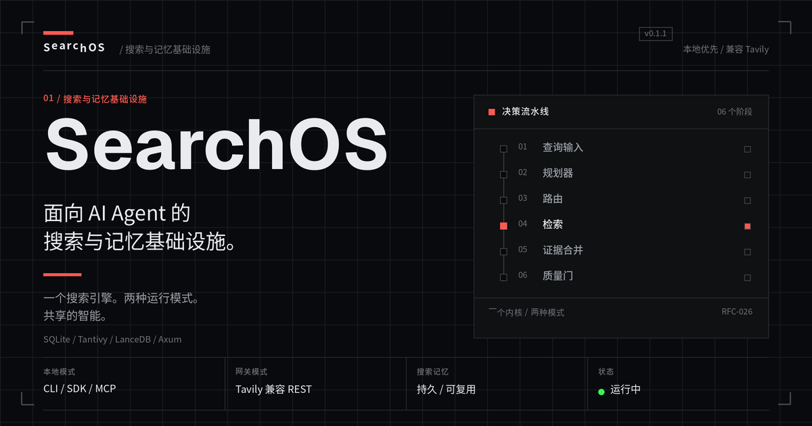
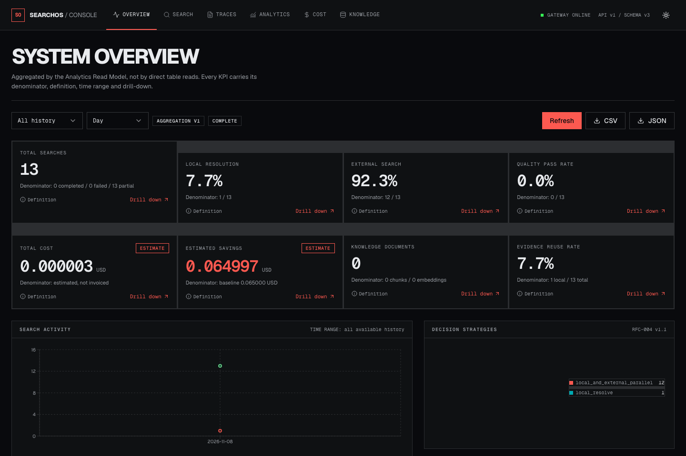
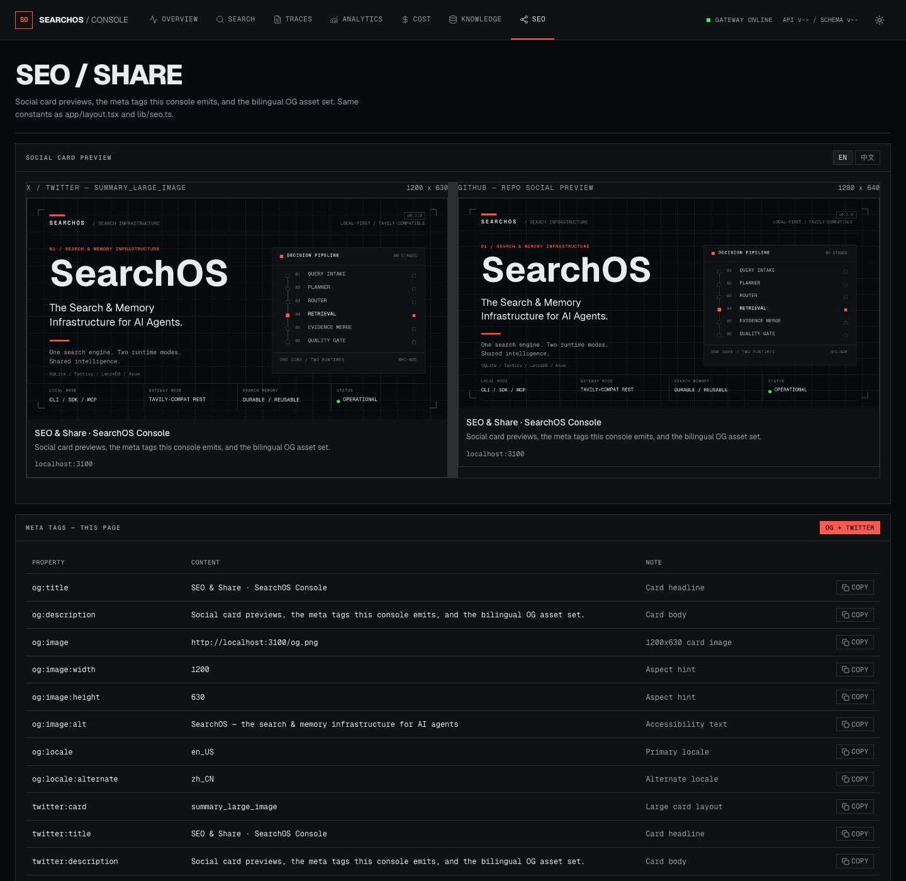

<p align="center">
  
</p>

<h1 align="center">SearchOS</h1>

<p align="center">
  <strong>面向 AI Agent 的搜索与记忆基础设施。</strong><br/>
  一个搜索引擎。两种运行模式。共享的智能。
</p>

<p align="center">
  
  
  
  
  
</p>

<p align="center">
  <a href="#快速开始">快速开始</a> ·
  <a href="#核心特性">核心特性</a> ·
  <a href="#可视化控制台">控制台</a> ·
  <a href="#架构总览">架构</a> ·
  <a href="#文档">文档</a> ·
  <a href="README.md">English</a>
</p>

---

## 为什么要做 SearchOS

AI Agent 工作流高度依赖 Web Search，但今天每个 Agent、每个工具、每个任务往往各用各的搜索服务
（Tavily、Brave、Exa……），由此带来：

- 相同或高度相似的搜索被反复执行。
- 不同搜索服务的额度无法统一管理、共享。
- 已经抓取的网页内容无法充分复用。
- 搜索结果缺乏持久化与知识积累。
- 不同网站的结构差异，通用爬虫无法稳定处理。
- 本地使用与服务器部署需要两套不同的使用方式。

SearchOS 用一套统一的基础设施解决这些问题。

## 核心特性

- **双运行模式（Dual Runtime）**——同一套 Rust Core 既可作为进程内 **Local Mode**（CLI / Rust SDK /
  MCP stdio）运行，也可作为 HTTP **Gateway Mode**（兼容 Tavily 的 REST + MCP）运行。
- **Tavily 兼容 API**——把现有客户端指向 `http://127.0.0.1:8787` 即可，工作流无需改动。
- **本地优先搜索**——优先从本地索引与记忆中返回答案，再决定是否访问外部搜索。
- **搜索记忆（Search Memory）**——搜索历史、文档版本、语义记忆、研究记忆都是一等公民级、可持续积累的资产。
- **混合检索（Hybrid Retrieval）**——BM25 + 向量 + 元数据，经 Reciprocal Rank Fusion（RRF）融合，并支持可插拔重排序。
- **可扩展核心**——Manifest 生命周期、权限、故障隔离的发现与隔离；原生 Provider 与网站爬虫随主程序编译。
- **成本感知路由**——综合质量、新鲜度、延迟、成本、可用性进行评分选择；并提供 Singleflight 请求合并。
- **分布式就绪（Distributed-ready）**——从数据模型与接口层面第一天就为多节点设计，但不在 v1 强制引入分布式复杂度。

## 可视化控制台

操作员控制台（`web/`）是基于网关 **Analytics Read Model** 的 Next.js 16 / React 19 界面——
浏览器从不直接读取业务表。

| 系统总览 | SEO / 分享 |
|---|---|
|  |  |

七个页面：**Overview**（带分母与定义的 KPI 卡片、活动/策略图表、导出）、**Search** 工作台、
**Traces**（分阶段决策时间线）、**Analytics**（搜索 / 成本 / 质量 / 知识 / Provider / 爬虫 /
基础设施）、**Cost**（台账、预留、对账）、**Knowledge**（文档、语义记忆、运行时健康）与
**SEO**（社交卡片预览 + 本站输出的 meta 标签）。Light / Dark 主题、直角战术遥测风格、
单一 hazard-red 强调色。详见 [docs/ui.md](docs/ui.md) 与 [web/README.md](web/README.md)。

## 快速开始

### 前置要求

- Rust 1.75+（`rustup`）
- Node.js 20+（仅控制台需要）

### 1. 构建并运行 CLI（Local Mode）

```bash
cargo build --release --bin searchos

# 数据目录由 SEARCHOS_DATA_DIR 指定（默认 ~/.searchos）
SEARCHOS_DATA_DIR=./data ./target/release/searchos init
SEARCHOS_DATA_DIR=./data ./target/release/searchos search "What is Rust ownership?" --mode local-only --format json
SEARCHOS_DATA_DIR=./data ./target/release/searchos doctor
```

### 2. 启动网关（Gateway Mode）

```bash
SEARCHOS_DATA_DIR=./data ./target/release/searchos gateway start --port 8787
```

### 3. 把 Tavily 客户端指向它

```bash
curl -s http://127.0.0.1:8787/search \
  -H 'content-type: application/json' \
  -d '{"query":"What is Rust ownership?","search_depth":"basic","max_results":5}'
```

### 4. 启动控制台

```bash
cd web
npm ci
npm run dev                     # http://localhost:3100
```

控制台通过 `/api/searchos/*` 代理访问网关的 `/api/v1/dashboard/*` Read Model；
`SEARCHOS_AUTH_TOKEN` 仅保存在服务端。生产环境：`npm run build && npm start`。

### MCP

```bash
searchos mcp                    # stdio MCP server：7 个 RFC-021 工具 + search_trace 别名
```

## 架构总览

```text
┌──────────────────────────────────────────┐
│              接口层 Interface Layer       │
│  CLI   ·   Rust SDK   ·   MCP   ·   HTTP API │
└──────────────────┬───────────────────────┘
                   │
┌──────────────────▼───────────────────────┐
│              应用层 Application Layer      │
│  搜索 · 抓取 · 爬虫 · 记忆 · 研究          │
└──────────────────┬───────────────────────┘
                   │
┌──────────────────▼───────────────────────┐
│              核心运行时 Core Runtime       │
│  查询 · 规划 · 路由 · 缓存 · 检索 ·         │
│  记忆 · 爬虫 · 扩展                       │
└──────────────────┬───────────────────────┘
                   │
┌──────────────────▼───────────────────────┐
│              基础设施 Infrastructure      │
│  SQLite · Tantivy · LanceDB · 文件/对象    │
│  + ES / Meili / PG / MySQL（可选）          │
│  队列 · Provider · Embedding · 浏览器      │
└──────────────────────────────────────────┘
```

详见 [`docs/architecture.md`](docs/architecture.md) 与正式设计文档
[`docs/rfc/README.md`](docs/rfc/README.md)。

## 仓库结构

```text
crates/                 Rust workspace：core、decision、planner、storage、
                        retrieval、interfaces（CLI / HTTP / MCP）、extensions
extensions/             站点爬虫与 Provider 清单
fixtures/               评测数据集（500 题）与测试夹具
tests/                  integration、e2e、performance、compatibility 测试
web/                    基于 Analytics Read Model 的 Next.js 16 控制台
docs/                   架构、RFC 套件、API/CLI 参考、ADR
```

## 开发与验证

```bash
cargo test --workspace          # 全部套件通过（精确数量由 CI 跟踪）
cargo clippy --workspace --all-targets
cargo fmt --all -- --check

cd web && npm ci && npm run typecheck && npm run build
```

CI 在每次 push / PR 时运行 fmt / clippy / test 以及控制台 typecheck + build
（[.github/workflows/ci.yml](.github/workflows/ci.yml)）。

## 开发路线图

以「可交付能力」推进的分阶段计划（约 16 周到达 v1.0）。完整内容见
[`docs/roadmap.md`](docs/roadmap.md)。

| 阶段 | 范围 |
|-----:|------|
| P0 | 架构基础：Workspace、核心 Trait、双运行模式 |
| P1 | 双运行模式 + Tavily 兼容搜索网关 |
| P2 | 文档与爬虫基础 |
| P3 | 本地检索与记忆 |
| P4 | 扩展系统 |
| P5 | AI 搜索智能 |
| P6 | Agent 集成（MCP、SDK） |
| P7 | 生产发布（v1.0） |

## 文档

- [架构说明](docs/architecture.md)
- [正式 RFC 套件（16 份 RFC + 附录 17–24 + RFC-026..029）](docs/rfc/README.md)
  - [RFC-001：产品架构](docs/rfc/rfc-001-product-architecture.md)
  - [RFC-004：搜索决策引擎](docs/rfc/rfc-004-search-decision-engine.md)
  - [附录 23：决策引擎工程基线（RFC-004 v1.1）](docs/rfc/part-23-decision-engineering-baseline.md)
  - [附录 24：接口 / 安全 / 可靠性 / 治理基线](docs/rfc/part-24-api-governance-baseline.md)
  - [RFC-026：可视化与分析层](docs/rfc/rfc-026-visualization-analytics-architecture.md)
  - [RFC-027：分析数据模型](docs/rfc/rfc-027-analytics-data-model.md)
  - [RFC-028：Dashboard API 与前端集成](docs/rfc/rfc-028-dashboard-api-frontend.md)
  - [RFC-029：本地数据导入与本地优先检索](docs/rfc/rfc-029-local-data-ingestion.md)
- [功能遗漏分析：源设计 vs. 实现](docs/gap-analysis.md)
- [RFC 实现缺口登记](docs/rfc-implementation-gaps.md)
- [可视化控制台（Next.js / React）](docs/ui.md) · [web/README.md](web/README.md)
- [HTTP API](docs/api/http.md) · [CLI 参考](docs/api/cli.md)
- [扩展与爬虫系统](docs/extensions.md)
- [路线图与 ADR](docs/roadmap.md)
- [文档中心](docs/index.md)
- [English README](README.md)

## 许可证

[MIT](LICENSE)。Open Core：社区版开源；托管与企业能力另行提供。
